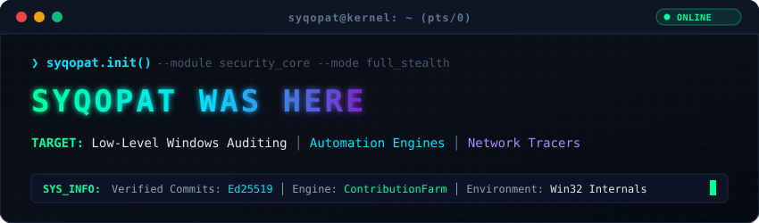

  

  
  
  

---

### Core Arsenal & Technologies

  
  
  
  
  
  

  
  
  
  
  
  

---

### Featured Projects Showcase

  

---

### Telemetry & Activity Metrics

  
  

  

---

### Contribution Activity Snake

  <picture>
    <source media="(prefers-color-scheme: dark)" srcset="https://raw.githubusercontent.com/Syqopat/Syqopat/output/github-contribution-grid-snake-dark.svg" />
    <source media="(prefers-color-scheme: light)" srcset="https://raw.githubusercontent.com/Syqopat/Syqopat/output/github-contribution-grid-snake.svg" />
    
  </picture>

---

  <code>[EOF] root@syqopat:~$ session_terminated --code 0x00 --status verified</code>

